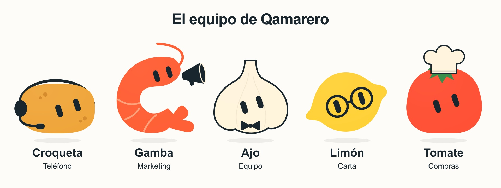
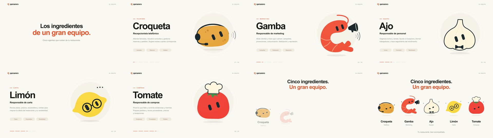

# Colección Ingredientes

Una segunda colección visual, basada en la referencia de Croqueta, Gamba, Ajo, Limón y Tomate. La colección Original y su presentación siguen disponibles.



| Personaje | Área | Identidad visual |
| --- | --- | --- |
| Croqueta | Teléfono | Cuerpo dorado con motas y auriculares oscuros |
| Gamba | Marketing | Silueta en C, bandas, cola, antena animada y megáfono |
| Ajo | Equipo | Bulbo crema con contorno, divisiones y pajarita |
| Limón | Carta | Cuerpo amarillo con extremos y montura circular oscura |
| Tomate | Compras | Cuerpo rojo, hojas verdes y gorro de chef crema |

## Usar ambas versiones

El selector «Original / Ingredientes» aparece encima del editor. Cambiar de colección conserva los cambios pendientes de la actual antes de cargar la otra. Si no se puede guardar, el cambio se bloquea para conservar el trabajo visible. Una vista sin cambios no sobrescribe una copia más reciente guardada desde otra pestaña.

El proyecto Original conserva su clave `qamarero-agent-studio-v1` y admite los JSON anteriores. Ingredientes usa `qamarero-agent-studio-ingredients-v1`. Sus JSON llevan el campo opcional `collection: "ingredients"` y se descargan como `qamarero-ingredients.json`. Importar una colección distinta conserva primero la que se estaba editando.

Acceso directo al editor: `/?coleccion=ingredientes`. La presentación individual y el cierre con los cinco están en `/?presentacion&coleccion=ingredientes`, o en «Presentar equipo» dentro de esta colección. Ambos reproductores enlazan a su MP4 correspondiente.

## Recursos y regeneración

Los cinco SVG fijos, sus versiones animadas, la lámina y el JSON están en `public/agents/ingredients/`. El vídeo de 30 segundos, 1920 × 1080 y 30 fps está en `public/presentations/equipo-qamarero-ingredientes.mp4`, con portada del mismo nombre. El MP4 anterior conserva su nombre y contenido.

```sh
pnpm generate:ingredients
pnpm render:presentation:ingredients
pnpm build
```

Los comandos originales siguen funcionando y producen los recursos originales. Las nuevas formas se dibujan en SVG y utilizan el motor de mirada, expresiones y parpadeo existente; la gamba usa un contorno cóncavo y un anclaje de rostro propio. El editor, la captura y las exportaciones utilizan el mismo renderer.

## Verificación

- 235 pruebas y compilación correctas.
- Comparación exacta del render de los cinco personajes originales con sus SVG guardados.
- Hash SHA-256 de 14 recursos anteriores, incluidos el vídeo y la portada: todos sin cambios.
- JSON antiguos, nuevas formas, expresiones y seis estados de animación comprobados.
- Cambios pendientes, accesorios y escenas conservados al alternar; pruebas de cuota agotada, importación y una copia más reciente de otra pestaña.
- MP4 nuevo verificado con `ffprobe`: H.264, 1920 × 1080, 900 fotogramas, 30 fps y duración exacta de 30 segundos.


