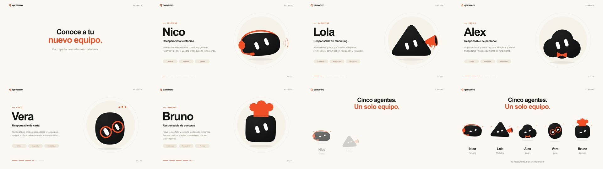

# Presentación del equipo de Qamarero

Animación horizontal de 30 segundos: entrada breve, presentación individual de los cinco agentes y cierre con todo el equipo.

| Tiempo | Agente | Función |
| --- | --- | --- |
| 0–1,2 s | Apertura | Conoce a tu nuevo equipo |
| 1,2–5,8 s | Nico · Teléfono | Recepcionista telefónico |
| 5,8–10,4 s | Lola · Marketing | Responsable de marketing |
| 10,4–15 s | Alex · Equipo | Responsable de personal |
| 15–19,6 s | Vera · Carta | Responsable de carta |
| 19,6–24,2 s | Bruno · Compras | Responsable de compras |
| 24,2–30 s | Los cinco juntos | Cinco agentes. Un solo equipo. |

Los nombres, funciones y responsabilidades siguen la tabla facilitada para la presentación. El catálogo del editor conserva sus identificadores y nombres anteriores; abrir la presentación no modifica el proyecto del usuario.

## Reproducir y descargar

El botón «Presentar equipo» abre el reproductor sobre el estudio, sin abandonar el editor ni perder cambios. También se puede abrir `/?presentacion` directamente. Permite pausar, reiniciar, buscar un instante e ir a cada personaje o al cierre. El movimiento reducido abre una portada estática y deja que el usuario inicie la reproducción.

El enlace «Descargar MP4» entrega `public/presentations/equipo-qamarero.mp4`: H.264, 1920 × 1080, 30 fps, 900 fotogramas y 30 segundos, sin audio. El MP4 tiene el índice al principio para reproducirse mientras se descarga. La portada es `public/presentations/equipo-qamarero.jpg`.

## Editar y volver a generar

`src/agents/presentation/story.ts` contiene nombres, roles, textos y tiempos. `render.ts` compone cada fotograma como SVG a partir del mismo renderer de personajes que utiliza el editor, incluidas las gafas corregidas. Todo depende del tiempo suministrado, por lo que se puede pausar, buscar o exportar cualquier fotograma.

```sh
pnpm install
pnpm render:presentation
pnpm build
```

El render offline necesita `ffmpeg` con `libx264`. `sharp` es una dependencia de desarrollo; no se incluye en el navegador. Se puede indicar otro binario mediante `QAMARERO_FFMPEG`. Los fotogramas se envían de uno en uno al codificador, sin acumular imágenes en disco. La tipografía utiliza Arial/Helvetica del sistema.

## Verificación

Compilación y 225 pruebas correctas. Las pruebas de la presentación comprueban el orden y los límites de los segmentos, la presencia de un solo personaje en cada presentación, los cinco en el cierre, el determinismo al buscar hacia atrás y la conservación de las gafas.

El archivo se inspeccionó con `ffprobe`: H.264, 1920 × 1080, 30 fps, 900 fotogramas y duración exacta de 30 segundos. La siguiente lámina se extrajo del MP4 terminado, incluyendo las cinco presentaciones y dos momentos del cierre.



Ejemplos de composición: [Nico](presentation-nico.jpg), [Vera](presentation-vera.jpg) y [Bruno](presentation-bruno.jpg).
